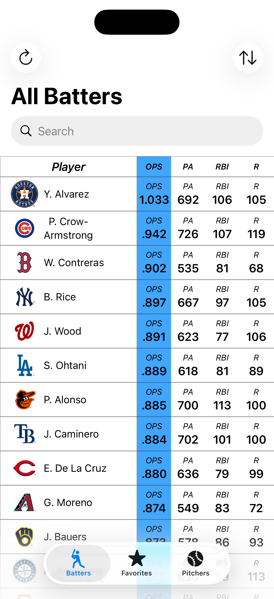
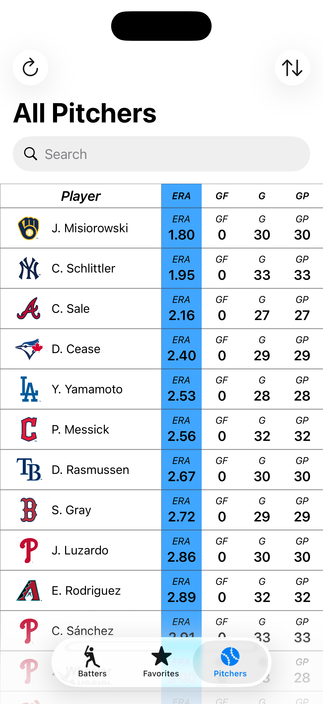

## SmartStats
SmartStats is a solution for staying up to date with MLB player statistics on iOS.

// GIF showing off app features

SmartStats is the solution for easily tracking a variety of MLB player statistics on iOS devices. It allows you to stay up to date with critical batting and pitching stats for qualified players, including batting average, OPS, ERA, and more. The clean, visually appealing, and easy-to-navigate UI eliminates the need to poke through dozens of screens in other applications to find the statistics you're pursuing. SmartStats leverages the official MLB API to allow tracking and ranking nearly every statistic available for qualified MLB players.

## Features
Upon launching the application, the user will be greeted with a list of qualified offensive players that can then be sorted by a specific statistic of their choosing, such as batting average, on-base-plus-slugging, slugging, home runs, etc.

   

Users can view all qualified MLB pitchers by selecting the "Pitchers" tab in the tab bar at the bottom of the screen. The results can then be sorted by a specific pitching or defensive metric such as earned-run average, strikeouts-per-nine innings, walks and hits per inning pitched, etc.

   

Additionally, users can favorite a specific player to add them to a subset of MLB batters and pitchers called "Favorites". These favorited players are much easier to access, which makes keeping up with player performance a breeze.

// Screenshot for Favorites View

Both the Batters view and the Pitchers view contain built-in search functionality that allows quick and easy lookup for any qualified player.

// Screenshot for search method

Tapping the name of any player displayed in the Batters view, Pitchers view, or Favorites view presents the Detail View for the desired player, which contains the stats for every season the corresponding player has played in Major League Baseball.

// Screenshot of the Detail View

## Screenshots

## Tech Stack
- Swift 5.x / SwiftUI
- MV Architecture
- URLSession & Codable for parsing JSON & Networking
- UserDefaults for Favorites persistence
- No third-party dependencies

## Getting Started
SmartStats is not yet available on Apple's App Store, but the repository can be downloaded, then opened and run in Xcode.

### Requirements
- Mac running Xcode version 27.x
- iOS version 26.x device/simulator

### Installation
1. Clone the repository:
   bash git clone url
2. Open 'SmartStats.xcodeproj' in Xcode
3. Press ⌘R to run the app via the simulator

No API Key or additional configuration is required

## Data Source
All player data used in SmartStats comes from the official MLB Stats API (statsapi.mlb.com). SmartStats fetches player stats, both batting and pitching, for qualified players. Career stats are also fetched for every player, season-by-season.

SmartStats is an independent project and is not affiliated with or endorsed by Major League Baseball. All MLB-related names and data are the property of their respective owners.
  
## Roadmap
Future updates will leverage Apple's CoreML framework to predict player statistics for future seasons and potentially predict stats on a per-game basis.

## License
This project is licensed under the PolyForm Noncommercial License 1.0.0. See [LICENSE](LICENSE.md) for details. Commercial use is not permitted.
